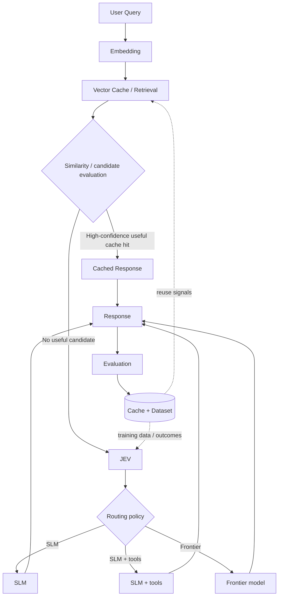

# Architecture

> **Epistemic status of this page:** it describes a *proposed* system. Every claim below is tagged with its position on the [evidence ladder](/progress#evidence-ladder). Nothing on this page is empirically validated yet. Current implementation state lives on the [Progress](/progress) page.

## 1. Purpose

LLM inference is expensive, and the cost is unevenly distributed across queries.

Observations that motivate this project (stated as observations to be tested, not as measured facts):

- LLM inference can be expensive, and cost scales with invocation count and model tier.
- Many queries may have reusable computation or semantically equivalent previous responses.
- Not every query requires the same model capability.
- A large fraction of production traffic may be answerable by cheaper means without an acceptable quality loss — *unverified*.

The system attempts to reduce unnecessary expensive inference through two mechanisms:

1. **Retrieval** — reuse a previous computation when one is sufficiently useful.
2. **Routing** — when reuse is not possible, send the query to the cheapest model that meets the required capability.

**No savings are claimed yet.** Cost and quality numbers belong in [Metrics](/progress#metrics), and until they are filled in from experiments they are targets, not results.

## 2. Architectural hypothesis

**State: `HYPOTHESIS`** — see [H-001](/progress#hypothesis-register) and [H-002](/progress#hypothesis-register).

The current architecture is a research hypothesis, not an established design. It asserts:

- Vector retrieval can determine whether useful prior computation exists for a query.
- JEV can determine an appropriate execution path when reuse is insufficient.
- An SLM can handle suitable lower-complexity workloads at acceptable quality.
- Frontier models are required only for workloads that exceed the acceptable capability/complexity threshold.
- Evaluation feedback can improve both cache decisions and JEV training over time.

Each of these is falsifiable and each has an open research question attached ([§8](#_8-research-questions)).

> The prohibited form is *"JEV is better than SLM for routing."*
> The required form is *"**Hypothesis:** a dedicated JEV classifier can route queries more efficiently than using an SLM as the routing component."* — then define the experiment and let the result decide.

## 3. Proposed architecture



Reading of the diagram:

1. A query is embedded.
2. The vector cache is searched for candidates.
3. Candidates are evaluated — this is where "is this actually reusable?" is decided, and it is expected to become more than a raw similarity test.
4. On a high-confidence useful hit, the cached response is returned.
5. Otherwise JEV produces a routing decision, and one of SLM / SLM + tools / Frontier generates the response.
6. The response is evaluated; outcomes update the cache and the dataset.
7. Cache signals and JEV training data feed back into retrieval policy and JEV.

**Status of the diagram:** proposed. Only step 0 (documentation) exists today. See [Progress → Engineering](/progress#workstreams).

## 4. Component responsibilities

| Component | Responsibility | Status |
|---|---|---|
| Embedding model | Turn query and response text into vectors | Existing (off-the-shelf; provider not fixed, see [§11](#_11-development-stack-bootstrap-under-free-tier)) |
| Vector database | Store vectors plus payload; run approximate nearest-neighbour search | Proposed (Qdrant shortlisted, not provisioned) |
| Retrieval layer | Generate candidate responses for a query | Not implemented |
| Intelligent cache policy | Decide whether a candidate is *usefully* reusable, beyond similarity | Research |
| JEV | Classify the query and choose an execution path | Research |
| Routing policy | Map the JEV decision onto an actual model invocation | Proposed |
| SLM | Serve lower-complexity workloads | Proposed (provider not fixed) |
| Frontier model | Serve workloads above the capability threshold | Proposed (provider not fixed) |
| Evaluation system | Score responses and produce outcome records | Not implemented |
| Dataset | Store queries, responses and outcomes for JEV training | Not implemented |
| Feedback/training pipeline | Turn outcome data into cache updates and JEV training signal | Not implemented |

**Status vocabulary:** `Existing / Proposed / Research / Not implemented` describes whether a component *exists*. It is a different vocabulary from task status and from claim state — see [Status vocabularies](/progress#status-vocabularies).

## 5. JEV

JEV is a custom-trained classifier/router whose job is to decide what computational path a query should take. It is **not** an answer-generation model, and it should not be described as one.

### 5.1 Output space

**Do not define JEV as `simple / medium / complex`.** The final output space is still under research.

Candidate routing actions — **candidates, not final decisions**:

| Candidate action | Intended meaning |
|---|---|
| `CACHE` | A cached response is usable; do not invoke a model |
| `SLM` | Route to the small/cheap model |
| `SLM + TOOL` | Route to the small model with tool access |
| `FRONTIER` | Route to the frontier model |
| `RETRIEVE_MORE` | Retrieval was inadequate; widen or re-run it |
| `REGENERATE` | The cached candidate was found, but is not acceptable to reuse |

The set, its granularity, and whether these are mutually exclusive classes or a scored distribution are all open (research question 3).

### 5.2 Inputs

JEV **may eventually** use some of the following. These are **proposed inputs, not confirmed inputs**:

- query representation (embedding or learned features)
- retrieved candidate information
- similarity scores
- uncertainty estimates
- query/domain characteristics
- historical outcomes

Which of these are actually used, how they are encoded, and whether any of them pay for their own inference cost are open (research questions 1, 2, 11).

### 5.3 Cost constraint

JEV itself costs money and latency to run. If it cannot beat a simpler router by more than it costs to invoke, it should not exist. This is the substance of research question 1 and the reason [§9](#_9-baselines) exists.

## 6. Intelligent Vector Cache

The vector store should not remain a mechanism of the form:

```text
embedding similarity > threshold → return cached response
```

That is the baseline to beat, not the design.

### 6.1 Candidate metadata

A stored cache entry may eventually carry:

`query`, `query embedding`, `response`, `response embedding`, `model used`, `model version`, `quality score`, `confidence`, `latency`, `cost`, `timestamp`, `freshness`, `reuse count`, `successful reuse count`, `failure count`, `domain`, `JEV classification`

These are **candidate fields**. The actual schema will evolve through experiments; nothing here is a decided schema.

### 6.2 Hypothesis

**State: `HYPOTHESIS`** — see [H-002](/progress#hypothesis-register).

> A semantically similar response is not automatically a good reusable response.

Therefore retrieval may eventually consider quality, reuse history, freshness, model/version provenance and other signals **in addition to** semantic similarity.

Storage capacity is not currently considered the primary bottleneck. The objective is to aggressively retain useful previous computations where doing so reduces API cost and latency — *and* to be able to tell "useful" from merely "similar", which is the part that has not been demonstrated.

## 7. Feedback loop

```text
Query
  → retrieval / routing
  → response
  → evaluation
  → outcome data
  → cache updates
  → JEV training data
  → improved routing
```

Why this matters: the system's long-term differentiation, if it has any, is expected to come from accumulated routing and evaluation data — the ability to learn which reuse decisions were correct and which routing choices were cheap *and* adequate.

**This is a potential source of differentiation that needs to be validated, not a defensible moat.** No moat claim is made. Whether the loop produces signal at all depends on the evaluation system existing, which it does not yet ([§4](#_4-component-responsibilities)).

## 8. Research questions

1. Can JEV classify/route queries accurately enough to justify its inference cost?
2. What should JEV's input representation be?
3. What should JEV's output/action space be?
4. How should cache usefulness be measured?
5. What similarity threshold or retrieval policy is appropriate?
6. Can cached responses maintain acceptable quality?
7. When should a cached answer be invalidated?
8. How should freshness be handled?
9. Does intelligent caching actually reduce API cost?
10. Does JEV routing improve the quality/cost/latency tradeoff compared with simpler baselines?
11. What is the cost of JEV itself?
12. How should training labels for JEV be generated?

## 9. Baselines

The architecture must eventually be compared against simpler systems. Architectural complexity must not be mistaken for improvement.

Candidate baselines:

1. Always use SLM
2. Always use Frontier
3. Vector cache + fixed threshold
4. Vector cache + simple rule-based router
5. Vector cache + JEV

Baseline 5 is only meaningful once 3 and 4 are measured. **No baseline is claimed to be better or worse until it is measured.**

The purpose of the list is to make it possible to discover that the proposed architecture is not an improvement — which is a valid and useful result.

## 10. Current status

Documentation foundation only. No JEV, no cache, no router, no model integrations.

See **[Progress](/progress)** for task state, hypotheses, the research log, decisions, and metrics.

## 11. Development stack (bootstrap under free tier)

Development is expected to run on free tiers / bootstrap budgets rather than paid infrastructure. Everything in this section is **shortlisted, unverified** — free-tier terms change frequently and must be re-checked before an experiment is designed around them. Record the date you verified a limit.

| Layer | Shortlisted choice | Free-tier shape (verify before relying on it) | Status |
|---|---|---|---|
| Vector DB | **Qdrant** | OSS self-host is free (Apache-2.0). Qdrant Cloud free tier: single node, 0.5 vCPU / 1 GB RAM / 4 GB disk, no credit card, no expiry — roughly 1M vectors at 768-dim. Free clusters suspend after ~1 week idle and are deleted after ~4 weeks. | Proposed |
| Embeddings | **Jina AI embeddings API** (cloud, fast) | New key receives 10M free tokens; free tier ≈ 500 RPM / 1M TPM. Candidates: `jina-embeddings-v5-text-nano` (768-dim), `jina-embeddings-v5-text-small` (1024-dim). | Proposed |
| Embeddings (alternatives) | Qdrant Cloud free inference on selected models; Google Gemini API free tier; local `fastembed` / `sentence-transformers` | Zero-cost fallbacks if a cloud free tier is unavailable or too slow. Local options remove rate limits entirely but move compute onto this machine. | Proposed |
| SLM / cheap model | **OpenRouter free models** (`:free` suffix) | No credit card; roughly 20 requests/minute and a few hundred requests/day per model. Candidates include `qwen/qwen3.8-27b:free`, `google/gemma-4-31b-it:free`, `nvidia/nemotron-3.5-lightning:free`. Free model availability churns — pin and re-check. | Proposed |
| Frontier model | **OpenAI API** | **There is no standing free tier.** New API accounts are prepaid (minimum ≈ $5); the old ~$5 signup credit was discontinued in 2025, and a ChatGPT Free account does *not* include API access. The only zero-cost route is the opt-in data-sharing program (free daily token allowance in exchange for sharing API traffic for training). | Proposed, with caveats |
| Frontier model (zero-cost alternatives) | Gemini API free tier; Anthropic one-time trial credit (≈$5, ~14-day expiry, SMS verification); OpenRouter paid frontier models billed against a small prepaid balance | Used only if the OpenAI route is unavailable. "Frontier" here means *the strongest model available under the current budget*, which may not be the actual frontier. | Proposed |
| Docs | VitePress (this site) | Local, free, no hosting cost; published to GitHub Pages. | Implemented |

**Accounting caveat:** a free tier makes measured API cost look like `$0`. That is not a cost reduction, it is a subsidy. Cost metrics ([Metrics → Cost](/progress#cost)) must be computed against list unit prices, not against the bill, or the central claim of the project becomes unfalsifiable.
